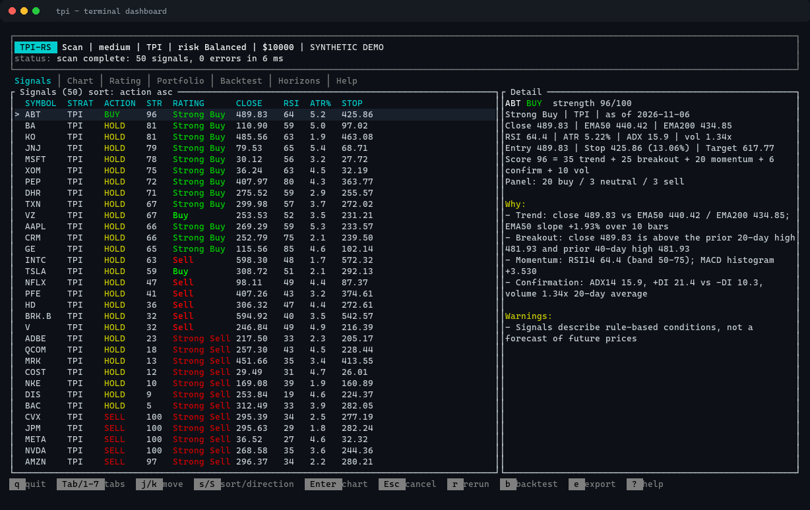
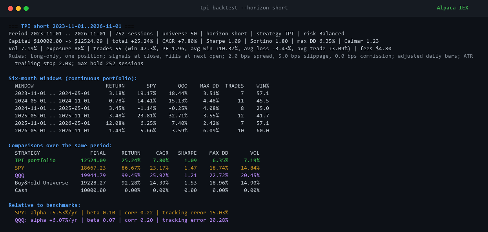

<div align="center">

# TPI-RS

**Super fast algorithmic trading for US stocks, built entirely in Rust.**

[](https://github.com/kingabzpro/tpi-rs/actions/workflows/ci.yml) [](https://github.com/kingabzpro/tpi-rs/releases/latest)   

</div>

<p align="center">
  <a href="docs/screenshots/tui.png">
    
  </a>
</p>

<p align="center"><sub>Captured on Windows 11 with real Alpaca bars (<code>tpi tui</code>): ranked signals, 26-vote rating, trade plan, chart, portfolio, backtests and the Picks tab.</sub></p>

TPI-RS is a Windows-native algorithmic trading system for US stocks. It scans for Donchian breakouts, confirms them with EMA trend, RSI, ATR and volume filters, adds a 26-vote technical rating, then backtests or trades the result through Alpaca. No Python, Docker, WSL, GPU or ML model.

## Results against SPY and QQQ

50 US stocks, Alpaca IEX adjusted bars, next-open fills, costs included, November 2023 to November 2026. This is the only comparison table in this README.

| Arm | Final | Total | CAGR | Sharpe | Sortino | Max DD | Vol | Calmar |
|---|---:|---:|---:|---:|---:|---:|---:|---:|
| TPI, 1.0% risk (default) | $10,913 | +9.13% | 2.96% | 0.65 | 0.97 | 5.15% | 4.71% | 0.58 |
| TPI, vol target 10% | $11,419 | +14.19% | 4.53% | 0.64 | 0.96 | 8.08% | 7.39% | 0.56 |
| TPI, 2.0% risk | $11,783 | +17.83% | 5.63% | 0.64 | 0.95 | 10.24% | 9.35% | 0.55 |
| TPI, 4.0% risk | $14,340 | +43.40% | 12.79% | 0.80 | 1.23 | 16.87% | 16.84% | 0.76 |
| SPY | $18,667 | +86.67% | 23.17% | 1.47 | 2.19 | 18.74% | 14.84% | 1.24 |
| QQQ | $19,945 | +99.45% | 25.92% | 1.21 | 1.78 | 22.72% | 20.45% | 1.14 |
| Equal-weight universe | $19,228 | +92.28% | 24.39% | 1.53 | 2.29 | 18.96% | 14.90% | 1.29 |
| Cash | $10,000 | 0.00% | 0.00% | 0.00 | 0.00 | 0.00% | 0.00% | 0.00 |

Read it straight. The four TPI rows are the same 54 trades at four sizing settings, so they are a sensitivity check, not four strategies. Every one of them loses to buy-and-hold, and raising risk only moves return and drawdown along one line: at 4.0% the strategy carries more volatility than SPY (16.84% against 14.84%) for less than half the return. At the default it beats SPY on drawdown alone, because a 1% budget against a 2.5 ATR stop keeps about 17.6% of equity deployed. The low drawdown is real. The outperformance is not. Windows and walk-forward: [docs/BENCHMARKS.md](docs/BENCHMARKS.md).

## Speed and memory

| Workload | Result |
|---|---:|
| Scan math, 100 symbols | 0.05 ms |
| Indicators, 100 symbols x 1,105 bars | 15.9 ms parallel, 25.3 ms single-thread |
| Backtest, 50 symbols x 783 sessions | 32.9 ms, about 1.19M symbol-days/s |
| Cold Top-100 scan over Alpaca | about 3.3 s, network-bound |
| Idle process | 8 MB |
| 100 symbols loaded | 98 MB |
| Windows binary | 6 MB |
| Repeatable scans | six concurrent scans byte-identical |

The hot path is a precomputed causal series per symbol, a Rayon scan over the universe, and a single reuse of that series across every backtest day and parameter set. There is no garbage collector, interpreter or model inference in the loop. Measured with `tpi perf`, which uses deterministic synthetic bars.

## Run it on Windows

No Rust or Cargo required.

[](https://github.com/kingabzpro/tpi-rs/releases/latest)

The release includes the Windows zip and a matching `.sha256` file. The zip contains `tpi.exe`, `config/default.toml`, `.env.example`, and `README.md`. Extract it and try the offline demo:

```powershell
.\tpi.exe --offline --tickers AAPL,MSFT,NVDA --mode scan --strategy compare
```

`--offline` generates deterministic demo bars. It does not read the cache, so drop it to get real prices.

For Alpaca data, copy `.env.example` to `.env`, add your paper keys, then run `.\tpi.exe doctor`. The Windows installer verifies the checksum and installs to `%LOCALAPPDATA%\TPI-RS`: [scripts/install-windows.ps1](scripts/install-windows.ps1).

## Commands

| Command | What it does |
|---|---|
| `tpi` | Interactive ticker, horizon, mode, strategy, risk and capital prompts |
| `tpi run AAPL,MSFT,NVDA` | Scan a ticker list |
| `tpi run` | Scan the Top 100 most-active US stocks |
| `tpi analyze AAPL` | One ticker in detail |
| `tpi backtest --horizon short` | Backtest one horizon |
| `tpi benchmark` | Three-year walk-forward benchmark |
| `tpi tui` | Terminal dashboard |
| `tpi paper --once --dry-run` | Paper order check |
| `tpi doctor` | Environment and API checks |

Every prompt has an equivalent flag, so scripts never need to answer questions. `--output json` works for scans, backtests and benchmarks. Sizing can be overridden with `--risk`, `--vol-target <pct>` and `--risk-pct <pct>`.

Dashboard keys: `1-8` switch tabs, `j/k` move, `s/S` sort, `R` cycles the risk profile, `r` reruns, `b` backtests, `e` exports, `Esc` cancels, `q` quits. The Picks tab shows the top five buy candidates from the current scan and the top five exit signals in your connected portfolio. It is read-only: no orders are submitted from the dashboard. On a day when nothing scores a BUY the buy half is empty, which is the strategy, not a fault.

## Automate paper trading

`tpi paper` already does what an "auto" mode would: it discovers the Top 100 most-active US stocks, scores them, manages exits, and holds one position at a time (`max_open_positions = 1`), refusing entries past `max_trades_per_day`, the daily loss limit or the kill switch.

```powershell
.\tpi.exe paper --top 100 --loop-secs 300     # one cycle every 5 minutes, until Ctrl-C
.\tpi.exe paper --top 100 --once              # a single cycle
.\tpi.exe paper --top 100 --once --dry-run    # decide, submit nothing
```

It submits orders only while the market is open. Outside hours it prints the signals it would have acted on, unless you pass `--wait-for-open`. Stop it with Ctrl-C, or create the kill-switch file named in `config/default.toml` and it exits before the next order. It prints a status block every cycle and sends no desktop notification, so fill alerts need the console in view.

## Learn more

- [Benchmark report, full tables and limitations](docs/BENCHMARKS.md)
- [Strategy rules and parameters](docs/STRATEGY.md)
- [Architecture and concurrency](docs/ARCHITECTURE.md)
- [Research review and rejected experiments](docs/RESEARCH.md)
- [Windows setup and troubleshooting](docs/SETUP-WINDOWS.md)
- [Testing guide](docs/TESTING.md)
- [Changelog](CHANGELOG.md)

> [!WARNING]
> Research software, not investment advice. Live trading is disabled by default and requires deliberate confirmations. Paper trade first, and read the walk-forward section of [docs/BENCHMARKS.md](docs/BENCHMARKS.md) before risking money.

<details>
<summary><strong>Console output</strong>: real short-horizon backtest</summary>
<br>



</details>
