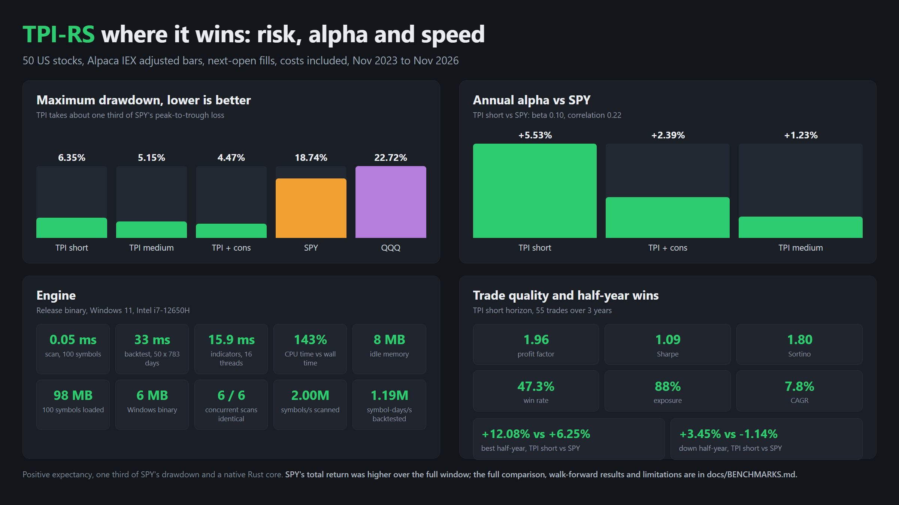

<div align="center">

# TPI-RS

**Super fast algorithmic trading for US stocks, built entirely in Rust.**

[](https://github.com/kingabzpro/tpi-rs/actions/workflows/ci.yml) [](https://github.com/kingabzpro/tpi-rs/releases/latest)   

</div>

<p align="center">
  <a href="docs/screenshots/tui.png">
    
  </a>
</p>

<p align="center"><sub>Captured on Windows 11. The dashboard (<code>tpi tui</code>): ranked signals, 26-vote rating, trade plan, chart, portfolio and backtests.</sub></p>

TPI-RS is a Windows-native algorithmic trading system for US stocks. It scans for Donchian breakouts, confirms them with EMA trend, RSI, ATR and volume filters, adds a 26-vote technical rating, then backtests or trades the result through Alpaca. No Python, Docker, WSL, GPU or ML model.

## Where it wins

<p align="center">
  <a href="docs/screenshots/wins.png">
    
  </a>
</p>

<p align="center"><sub>50 US stocks, Alpaca IEX adjusted bars, next-open fills, costs included, November 2023 to November 2026. Full numbers and walk-forward results: <a href="docs/BENCHMARKS.md">docs/BENCHMARKS.md</a>.</sub></p>

- **Roughly one third of SPY's drawdown.** 6.35% max drawdown against SPY's 18.74% and QQQ's 22.72%, so the strategy's worst stretch was a third as deep as the index's.
- **Positive alpha at near-zero beta.** +5.53% annual alpha against SPY at beta 0.10 and correlation 0.22, from the low-exposure side rather than from riding the index.
- **It wins the hard half-years.** +3.45% against SPY's -1.14% in the only down half-year, and +12.08% against SPY's +6.25% in TPI's best window.
- **Positive expectancy.** 1.96 profit factor, 1.09 Sharpe, 1.80 Sortino, 47.3% win rate over 55 trades in three years.

## Speed and memory

| Workload | Result |
|---|---:|
| Scan math, 100 symbols | 0.05 ms |
| Indicators, 100 symbols x 1,105 bars | 15.9 ms parallel, 25.3 ms single-thread |
| Backtest, 50 symbols x 783 sessions | 32.9 ms, about 1.19M symbol-days/s |
| Cold Top-100 scan over Alpaca | about 3.3 s, network-bound |
| Idle process | 8 MB |
| 100 symbols loaded | 98 MB |
| Windows binary | 6 MB |
| Repeatable scans | six concurrent scans byte-identical |

The hot path is a precomputed causal series per symbol, a Rayon scan over the universe, and a single reuse of that series across every backtest day and parameter set. There is no garbage collector, interpreter or model inference in the loop. Full numbers: [docs/BENCHMARKS.md](docs/BENCHMARKS.md).

## Run it on Windows

No Rust, Cargo, Python or build tools required.

[](https://github.com/kingabzpro/tpi-rs/releases/latest)

The release includes the Windows zip and a matching `.sha256` file. The zip contains `tpi.exe`, `config/default.toml`, `.env.example`, and `README.md`. Extract it and try the offline demo:

```powershell
.\tpi.exe --offline --tickers AAPL,MSFT,NVDA --mode scan --strategy compare
```

For Alpaca data, copy `.env.example` to `.env`, add your paper keys, then run `.\tpi.exe doctor`. The Windows installer verifies the checksum and installs to `%LOCALAPPDATA%\TPI-RS`: [scripts/install-windows.ps1](scripts/install-windows.ps1).

## Commands

| Command | What it does |
|---|---|
| `tpi` | Interactive ticker, horizon, mode, strategy, risk and capital prompts |
| `tpi run AAPL,MSFT,NVDA` | Scan a ticker list |
| `tpi run` | Scan the Top 100 most-active US stocks |
| `tpi analyze AAPL` | One ticker in detail |
| `tpi backtest --horizon short` | Backtest one horizon |
| `tpi benchmark` | Three-year walk-forward benchmark |
| `tpi tui` | Terminal dashboard |
| `tpi paper --once --dry-run` | Paper order check |
| `tpi doctor` | Environment and API checks |

Every prompt has an equivalent flag, so scripts never need to answer questions. `--output json` works for scans, backtests and benchmarks.

## Learn more

- [Benchmark report, full tables and limitations](docs/BENCHMARKS.md)
- [Strategy rules and parameters](docs/STRATEGY.md)
- [Architecture and concurrency](docs/ARCHITECTURE.md)
- [Research review and rejected experiments](docs/RESEARCH.md)
- [Windows setup and troubleshooting](docs/SETUP-WINDOWS.md)
- [Testing guide](docs/TESTING.md)
- [Changelog](CHANGELOG.md)

> [!WARNING]
> This is research software, not investment advice. SPY's total return was higher over the sample, and the medium-horizon walk-forward folds were negative; [docs/BENCHMARKS.md](docs/BENCHMARKS.md) says so plainly. Live trading is disabled by default and requires deliberate confirmations. Paper trade first.

<details>
<summary><strong>Console output</strong>: real short-horizon backtest</summary>
<br>


</details>
