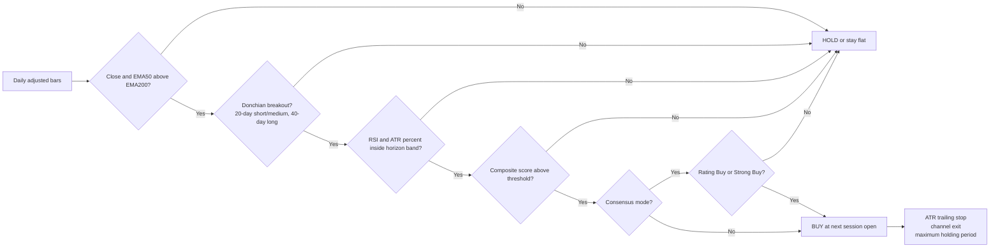
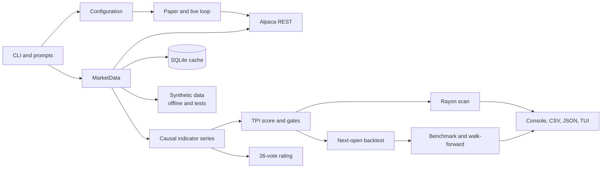

# TPI-RS

**A small, deterministic Rust trading system for US stocks.**

[](https://github.com/kingabzpro/tpi-rs/actions/workflows/ci.yml)
[](https://github.com/kingabzpro/tpi-rs/releases/latest)
[](LICENSE)


TPI-RS scans US stocks, scores Donchian breakouts with trend, momentum and volatility filters, adds a 26-vote technical rating, backtests the result, and can trade it through Alpaca. It ships as a single native binary and a terminal dashboard. No Python, no Docker, no WSL, no GPU, no AI model.

> [!WARNING]
> This is research software, not investment advice. Markets can and will lose money. The live trading path is disabled by default and requires several deliberate confirmations. Paper trade first. The strategy underperformed SPY in the published three-year test; the report shows that plainly.

## Download and run

You do not need Rust, Cargo, Python or a build toolchain to use a release binary.

| Platform | Download |
|---|---|
| Windows 10/11 x64 | [Latest release](https://github.com/kingabzpro/tpi-rs/releases/latest), file `tpi-rs-*-x86_64-pc-windows-msvc.zip` |
| Linux x64 | [Latest release](https://github.com/kingabzpro/tpi-rs/releases/latest), file `tpi-rs-*-x86_64-unknown-linux-gnu.tar.gz` |
| Source | `git clone https://github.com/kingabzpro/tpi-rs.git` |

Every release includes a SHA-256 checksum. The zip or tarball contains the executable, `config/default.toml`, `.env.example`, `README.md` and `LICENSE`.

### Windows

```powershell
# After extracting the release zip
cd .\tpi-rs-v0.1.0-x86_64-pc-windows-msvc
Copy-Item .env.example .env      # optional, for Alpaca market data
notepad .env                    # add your paper API key and secret
.\tpi-rs.exe --doctor           # with keys
.\tpi-rs.exe --offline --doctor # without keys
.\tpi-rs.exe
```

If you only want to see it work, offline mode needs no keys and no network:

```powershell
.\tpi-rs.exe --offline --tickers AAPL,MSFT,NVDA --mode scan --strategy compare
```

### Linux

```bash
tar -xzf tpi-rs-v0.1.0-x86_64-unknown-linux-gnu.tar.gz
cd tpi-rs-v0.1.0-x86_64-unknown-linux-gnu
cp .env.example .env
./tpi-rs --doctor          # with keys
./tpi-rs --offline --doctor # without keys
./tpi-rs
```

The Linux build uses the system OpenSSL. On a minimal distribution install `libssl3` (or `libssl-dev` if building from source). The Windows build uses Schannel through `native-tls`, so there is no OpenSSL dependency.

Or use the installer script, which downloads the latest release, verifies its SHA-256 checksum and extracts it to `%LOCALAPPDATA%\TPI-RS`:

```powershell
Invoke-WebRequest https://raw.githubusercontent.com/kingabzpro/tpi-rs/main/scripts/install-windows.ps1 -OutFile install-windows.ps1
.\install-windows.ps1
```

The script is short and readable. Review it before running it.

> [!NOTE]
> Windows SmartScreen may warn because the binary is unsigned. Choose **More info** then **Run anyway**, or build it yourself from source.

## What it does

| Area | What you get |
|---|---|
| Strategy | Donchian 40/20 channels, EMA 50/200 trend, RSI 14, ATR 14, ADX and volume confirmation, ATR trailing stop |
| Ratings | 26-vote panel with Strong Sell, Sell, Neutral, Buy, Strong Buy |
| Horizons | Separate short (1-5 days), medium (1-4 weeks) and long (1-6 months) parameter sets |
| Scanning | Single ticker, explicit list, or Top-100 most-active US equities, fetched concurrently |
| Backtesting | Next-session fills, spread, slippage, commissions, SEC/TAF fees, six-month windows |
| Validation | Walk-forward selection, parameter stability, untouched out-of-sample holdout |
| Trading | Alpaca paper by default; gated live execution with kill switch and flatten |
| Dashboard | Sortable signals, price chart, rating panel, portfolio, backtest tables, progress and exports |
| Evidence | 56 tests, mock exchange, no-lookahead checks, performance harness, release checksums |

## How a signal is made



The score is built from five buckets: trend (35), breakout (25), momentum (20), confirmation (10) and volatility (10). A high score alone is not enough. The hard gates above must also pass. Full rules and per-horizon parameters are in [docs/STRATEGY.md](docs/STRATEGY.md).

The technical rating is separate from the TPI score. It aggregates 15 moving-average votes and 11 oscillator votes. It is a consensus gauge, not a price forecast, and pure TPI mode does not use it.

## Reality check: it did not beat the index

Real Alpaca data, 2023-11-01 to 2026-11-01, 50 large-cap US stocks, IEX feed, adjusted daily bars, $10,000 starting capital, balanced risk, medium horizon.

| Strategy | Final | Total return | CAGR | Sharpe | Max drawdown | Trades |
|---|---:|---:|---:|---:|---:|---:|
| TPI | $10,913 | +9.13% | +2.96% | 0.65 | 5.15% | 54 |
| TPI + Consensus | $11,415 | +14.15% | +4.52% | 0.87 | 4.47% | 55 |
| SPY buy and hold | $18,667 | +86.67% | +23.17% | 1.47 | 18.74% | - |
| QQQ buy and hold | $19,945 | +99.45% | +25.92% | 1.21 | 22.72% | - |
| Equal-weight universe | $19,228 | +92.28% | +24.39% | 1.53 | 18.96% | - |
| Cash | $10,000 | 0.00% | 0.00% | 0.00 | 0.00% | - |

> [!IMPORTANT]
> The strategy lost to buy-and-hold over this period. All four walk-forward out-of-sample folds were negative, and the untouched final six months returned -0.66%. The low drawdown came from low exposure, not from superior timing. Read [docs/BENCHMARKS.md](docs/BENCHMARKS.md) before drawing conclusions, and do not treat the in-sample stability table as evidence of alpha.

The likely bottleneck is portfolio construction, not the breakout rule: one position at a time, 1% risk per trade, and often only 10-25% of equity deployed. The research review lists the experiments that could change that: [docs/RESEARCH.md](docs/RESEARCH.md).

## Speed and footprint

Measured on an Intel i7-12650H (10 cores, 16 threads), 16 GB RAM, Windows 11, release build with LTO.

| Workload | Result |
|---|---:|
| Indicator series, 100 symbols x 1,105 bars | 15.9 ms parallel, 25.3 ms single-thread |
| Indicator throughput | 6.96M bars/s |
| Scan evaluation, 100 symbols | 0.05 ms mean |
| Backtest, 50 symbols x 783 sessions | 32.9 ms, about 1.19M symbol-days/s |
| Working set, 100 symbols loaded | 98 MB |
| Release binary | 5.9 MB |

These are synthetic-data measurements, not trading results. `tpi-rs --perf` reproduces them on your machine.

## The dashboard

TPI-RS has a Ratatui terminal dashboard with a signal table, chart, rating panel, read-only paper portfolio, backtest windows, recent trades, and a Horizons tab that compares short, medium and long recommendations side by side.

A real captured screen is in [docs/tui-signals.txt](docs/tui-signals.txt).

| Key | Action |
|---|---|
| `q` | Quit |
| `Tab` or `1`-`7` | Switch tabs |
| `j` / `k` | Move selection |
| `s` / `S` | Cycle sort column / reverse direction |
| `Enter` | Open the selected symbol chart |
| `Esc` | Cancel a running scan or backtest |
| `r` | Rerun the current job |
| `b` / `a` | Run a backtest / scan |
| `e` | Export CSV and JSON |
| `?` | Help |

## Build from source

You need Rust 1.88 or newer and the MSVC C++ Build Tools on Windows. Step-by-step instructions, including the exact `winget` commands and troubleshooting, are in [docs/SETUP-WINDOWS.md](docs/SETUP-WINDOWS.md).

```powershell
git clone https://github.com/kingabzpro/tpi-rs.git
cd tpi-rs
cargo build --release
.\target\release\tpi-rs.exe --doctor
```

Linux:

```bash
sudo apt-get install -y build-essential pkg-config libssl-dev
cargo build --release
./target/release/tpi-rs --doctor
```

## Command examples

| Goal | Command |
|---|---|
| Interactive prompts | `tpi-rs` |
| One ticker in detail | `tpi-rs --tickers AAPL --mode analyze --horizon medium` |
| Top-100 short scan | `tpi-rs --top 100 --mode scan --horizon short --strategy consensus` |
| Compare TPI and consensus | `tpi-rs --tickers AAPL,MSFT,NVDA --mode scan --strategy compare` |
| Three-year benchmark | `tpi-rs --mode benchmark --strategy compare --export reports` |
| Separate horizon backtests | `tpi-rs --mode backtest --horizon short` |
| Paper trading, one dry run | `tpi-rs --mode paper --once --dry-run` |
| Dashboard | `tpi-rs --tui --tickers AAPL,MSFT,NVDA --mode scan` |
| Offline demo | `tpi-rs --offline --tickers AAPL,MSFT --mode scan` |
| Performance harness | `tpi-rs --perf` |
| Setup checks | `tpi-rs --doctor` |

All startup prompts have equivalent flags, so scripts never need to answer questions. `--output json` is available for scans, backtests and benchmarks.

## Alpaca setup

1. Create an Alpaca account and generate **paper** API keys.
2. Copy `.env.example` to `.env`.
3. Set `ALPACA_API_KEY` and `ALPACA_SECRET_KEY`.
4. Keep `TPI_ALPACA_FEED=iex` unless you have a SIP subscription.
5. Run `tpi-rs --doctor`.

Live trading is a separate decision. It requires `allow_live = true`, `paper = false`, `--i-understand-live-risk`, and typing `LIVE` at an interactive terminal. There are hard ceilings on order notional, daily loss, open positions and trades per day. A `KILL` file in the working directory blocks new orders, and `--flatten` cancels everything and closes positions.

## Architecture



Data is fetched concurrently in bounded chunks, cached in SQLite, evaluated with Rayon, and reused across every backtest day and parameter set. The detailed module map and concurrency model are in [docs/ARCHITECTURE.md](docs/ARCHITECTURE.md).

## Project layout

```text
src/
  main.rs, cli.rs, config.rs        entry point, flags, prompts, TOML config
  model.rs                          bars, signals, ratings, horizons
  indicators/                       causal series and the 26-vote rating
  strategy/                         score, hard gates, sizing, stops
  data/                             Alpaca client, SQLite cache, discovery, synthetic data
  backtest/                         engine, metrics, six-month benchmark, walk-forward
  scan.rs, paper.rs, live.rs        concurrent scanning and broker execution
  tui/                              Ratatui dashboard
  report.rs, perf.rs                exports, process metrics, performance harness
scripts/install-windows.ps1         no-Rust Windows installer
tests/                              unit, property, mock exchange, execution, concurrency, CLI
benches/                            Criterion microbenchmarks
config/default.toml                 defaults, universe, profiles
benchmarks/2026-11-08/              recorded benchmark artifacts
docs/                               setup, strategy, architecture, audit, research, benchmarks
```

## Tests and checks

```powershell
cargo test
cargo clippy --all-targets -- -D warnings
cargo fmt --all -- --check
cargo bench --bench indicators
cargo bench --bench backtest
```

The suite covers hand-checked indicator values, property-based invariants, no-lookahead truncation, next-open fill accounting, a local mock Alpaca exchange, concurrent deterministic scans, live safety gates, CSV/JSON exports and end-to-end CLI JSON.

## Research and next steps

The research review compares this implementation with the time-series momentum and trend-following literature and with its own benchmark evidence. The main conclusions:

- The single-position, fixed-risk design caps participation. More breadth and portfolio volatility targeting are the highest-value experiments.
- The 20-session time stop may be cutting the right tail that pays for trend following.
- The technical rating has not been validated against forward returns. Measure information coefficient before trusting it.
- The 18-combination walk-forward grid is too small to prove an edge. Use purged splits, cost stress and a Deflated Sharpe gate.

Read the full review, references and acceptance criteria in [docs/RESEARCH.md](docs/RESEARCH.md).

## Documentation

- [Windows setup and troubleshooting](docs/SETUP-WINDOWS.md)
- [Strategy rules and parameters](docs/STRATEGY.md)
- [Architecture and concurrency](docs/ARCHITECTURE.md)
- [Research review and improvement plan](docs/RESEARCH.md)
- [Upstream audit](docs/AUDIT.md)
- [Benchmark report](docs/BENCHMARKS.md)
- [Testing guide](docs/TESTING.md)
- [Changelog](CHANGELOG.md)

## License

MIT. See [LICENSE](LICENSE).

If you use this for real money, you own the outcome. Start with paper trading, size small, and keep a kill switch within reach.
