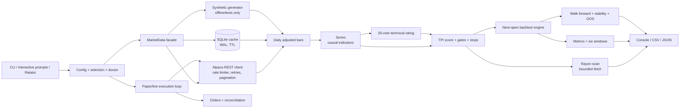

# Architecture

TPI-RS is a single Rust crate with a library (`tpi_rs`) and one binary (`tpi`). It separates data acquisition, causal analytics, strategy decisions, portfolio simulation, execution and presentation. No component reaches around another to mutate shared state.

## 1. System diagram



### ASCII view

```text
+----------------------------- presentation ------------------------------+
| Clap CLI | interactive prompts | Ratatui dashboard | console reports   |
+----------------+-------------------------------------------+------------+
                 |                                           |
          +------v-------+                            +------v------+
          | Config/doctor|                            | Report/export|
          +------+-------+                            +------+------+
                 |                                           ^
          +------v-------------------------------------------+------+
          | MarketData facade                                       |
          |  +----------------+  +-------------+  +--------------+  |
          |  | Alpaca REST    |  | SQLite cache|  | synthetic    |  |
          |  | limiter/retry  |  | WAL + TTL   |  | demo/tests   |  |
          |  +--------+-------+  +------+------+  +------+-------+  |
          +-----------|----------------|----------------|----------+
                      +----------------+----------------+
                                       |
                              +--------v--------+
                              | Series (causal) |
                              | ta + manual     |
                              | 26-vote rating  |
                              +--------+--------+
                                       |
                    +------------------+------------------+
                    |                                     |
          +---------v----------+               +----------v-----------+
          | Strategy evaluation|               | Backtest engine      |
          | score + hard gates |               | next-open, 1 position|
          | stops/sizing       |               | fees/slippage/stops  |
          +---------+----------+               +----------+-----------+
                    |                                     |
          +---------v----------+               +----------v-----------+
          | Rayon scan         |               | metrics, windows,    |
          | cancellation       |               | walk-forward, OOS    |
          +---------+----------+               +----------+-----------+
                    +------------------+------------------+
                                       |
                              +--------v--------+
                              | CSV / JSON / TUI|
                              +--------+--------+
                                       |
                              +--------v--------+
                              | Paper/live loop |
                              | Alpaca orders   |
                              +-----------------+
```

## 2. Module map

| Module | Responsibility |
|---|---|
| `main.rs` | Parse flags, load config, route modes, doctor, JSON output, TUI launch |
| `cli.rs` | Clap definition, interactive prompts, selection resolution, profiles |
| `config.rs` | TOML defaults, environment overrides, validation, path discovery |
| `model.rs` | `Bar`, `Signal`, `Rating`, `Horizon`, score breakdown, risk profiles |
| `indicators/mod.rs` | `Series`, ta-backed EMA/SMA/MACD/CCI, Wilder RSI/ATR/ADX, channels, oscillators |
| `indicators/ratings.rs` | Full 26-vote panel and allocation-light `rating_fast` |
| `strategy/mod.rs` | TPI score, hard gates, actions, explanations, fast path |
| `strategy/risk.rs` | Stop-distance sizing, initial and trailing stops |
| `data/alpaca.rs` | REST client, auth, token bucket, retries, orders, clock, discovery |
| `data/cache.rs` | SQLite schema, coverage, upsert, refresh metadata |
| `data/synthetic.rs` | Deterministic SplitMix64 synthetic OHLCV |
| `data/universe.rs` | Ticker parsing, Top-N discovery, fallback |
| `data/mod.rs` | Cache/fetch policy, provenance, warnings, missing-symbol handling |
| `scan.rs` | Symbol resolution, batched load, Rayon evaluation, deterministic ranking |
| `backtest/engine.rs` | Prepared data, daily engine, stops, fills, comparisons |
| `backtest/metrics.rs` | CAGR, Sharpe, Sortino, drawdown, windows, alpha/beta |
| `backtest/benchmark.rs` | Headline legs, walk-forward, stability, untouched OOS |
| `backtest/types.rs` | Result and config structs |
| `paper.rs` | Shared paper/live execution loop, risk checks, order polling, flatten |
| `live.rs` | Live preflight, typed confirmation, hard safety ceilings |
| `tui/mod.rs` | Dashboard state, background jobs, channels, charts, exports |
| `report.rs` | Console tables and CSV/JSON writers |
| `perf.rs` | Windows/Linux process memory and CPU metrics |
| `perf_harness.rs` | Latency/throughput/memory/CPU harness |

## 3. Request lifecycle

1. **Startup.** `.env` is loaded, config is read, normalized and validated, directories are created. `--doctor` verifies credentials, clock, account, cache and a small SPY history request.
2. **Selection.** Flags or prompts produce tickers/top-N, horizon, mode, strategy, risk profile and capital. Backtest/benchmark use a universe list instead of scan discovery.
3. **Market data.** `MarketData` checks the SQLite coverage and TTL. It fetches only missing ranges, or full ranges after `--refresh`, in symbol chunks of 10 with at most four concurrent requests. Adjusted bars are upserted. If the network fails but the requested range is fully cached, the cache is used with a warning; otherwise the error is returned.
4. **Analytics.** Each symbol gets one `Series` computed over the loaded history. All values are causal. Scan evaluation runs in Rayon; backtests reuse the same series across all days and parameter combinations.
5. **Decision.** The strategy produces an action, score, rating, stop, target and explanations. Scans rank BUY first, then strength, rating and symbol. Backtests schedule the strongest BUY for the next open.
6. **Simulation or execution.** The backtest applies the next open, fees, spread, slippage, stops and final liquidation. Paper/live reads account, positions and open orders from Alpaca as the source of truth, submits market orders and reconciles by client order id.
7. **Reporting.** Console tables, JSON and CSV. TUI results stream over an unbounded Tokio channel.

## 4. Concurrency model

- **Tokio multi-thread runtime** for HTTP, sleeping, signals and TUI jobs.
- **Rayon global pool** for indicator evaluation, scans and parameter sweeps. Rayon is not nested inside another Rayon parallel iterator.
- **Network bounding:** symbol chunks of 10 and `buffer_unordered(4)` cap market-data requests. A token bucket enforces `rate_limit_per_min` (default 180).
- **Backtest sweeps:** grid combinations run in parallel; each run is independent and owns its state. Stability rows are also independent.
- **No oversubscription:** a scan uses one Rayon parallel iterator, not one pool per request. The TUI does not spawn a thread per symbol.
- **Shared state:** the SQLite connection is behind a `Mutex`. Request rate state is an async `Mutex`. No strategy or portfolio state is shared between workers. The broker, not local memory, is authoritative for accounts and positions.
- **Cancellation:** scan and backtest progress callbacks read an `AtomicBool`; Esc sets it. The TUI aborts the job task on exit. Network calls cannot be interrupted mid-request but stop at the next boundary.
- **TUI input:** crossterm events are polled with a short timeout on the UI task while jobs run on other runtime workers.

## 5. Memory and performance choices

- One series per symbol per run, computed once and reused for every backtest day and every parameter combination; vectors of `f64` and `Option<f64>` aligned to bar indexes. A 100-symbol, 1,105-bar workload fits in roughly 100 MB of process working set including the allocator and HTTP client.
- `rating_fast` avoids building string vote lists in backtests. `evaluate_fast` skips explanation strings and detailed vote vectors.
- `ta` is used for EMA, SMA, MACD and CCI. Wilder RSI/ATR/ADX and the remaining oscillators are implemented directly so definitions are visible and testable.
- The release profile uses fat LTO, one codegen unit, `panic=abort` and symbol stripping. The resulting executable is about 5.9 MB.
- The cache avoids re-downloading years of bars for repeated scans and benchmarks. Adjusted-price consistency is handled by the TTL and `--refresh`.

## 6. Execution and safety architecture

- Paper is the default. Live requires several independent gates: `allow_live`, `paper=false`, a CLI acknowledgement, an interactive typed phrase, hard ceilings and valid credentials.
- The kill-switch file is checked before cycles and again after analysis. A daily-loss breach blocks new entries but does not block exits.
- Orders use `client_order_id`. After an ambiguous network failure the client looks the order up instead of resending it. Writes are never blindly retried.
- Open orders and positions are re-read every cycle. Partial fills are reported and reconciled on the next cycle.
- `--flatten` cancels all orders and closes all positions, with an additional typed confirmation in live mode.
- Ctrl+C stops the loop and can flatten if `flatten_on_exit` is enabled.
- No secrets are logged. Error messages redact nothing because they never contain the secret values.

## 7. Determinism and testability

- No random numbers in strategy, sizing or portfolio accounting. Synthetic data uses a seeded deterministic generator.
- Candidate ties break on rating and symbol.
- Same input bars, config and capital produce identical signals, trades, equity and JSON ordering.
- Tests cover causal invariants, truncation equivalence, next-open fills, fee arithmetic, mock exchange behaviour, concurrent scans and safety gates. See `TESTING.md`.

## 8. Extension points

- Add an indicator in `indicators/mod.rs` and a vote in `ratings.rs`.
- Add a horizon parameter set in `config/default.toml` and `Horizon::params`.
- Add an execution venue behind the `AlpacaClient` shape rather than coupling the strategy to HTTP.
- Add a new report in `report.rs`; result structs are already serializable.
- Extend walk-forward grids in `[backtest.walk_forward]`; keep the training/test separation intact.
