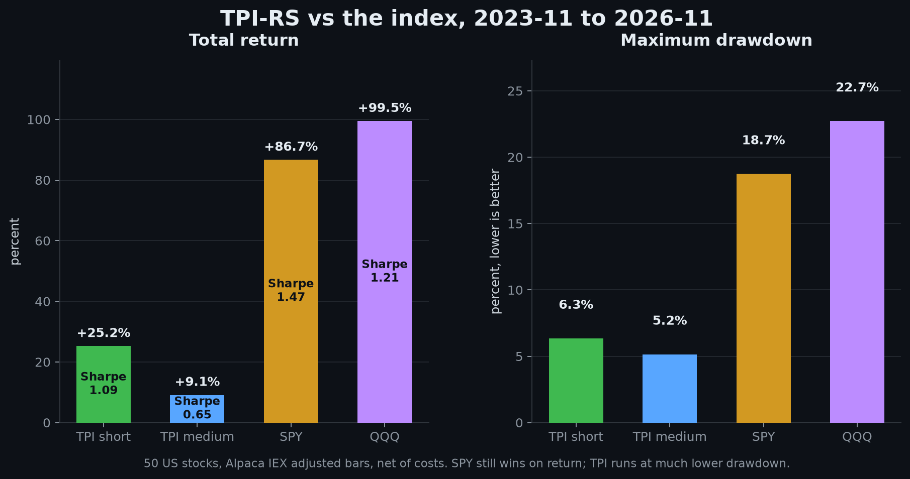

# Benchmark Report

All numbers below were produced on the machine described in section 1 with the release binary from this repository. Trading results use real Alpaca daily bars over the stated period. Performance-harness numbers use deterministic synthetic data and are not trading results.

## 1. Environment

| | |
|---|---|
| CPU | Intel Core i7-12650H, 10 cores / 16 logical processors |
| RAM | 16 GB |
| OS | Windows 11 Home, build 10.0.26300 |
| Rust | 1.99.1, stable-x86_64-pc-windows-msvc |
| Build | `cargo build --release` (opt-level 3, fat LTO, one codegen unit, panic=abort, stripped) |
| Binary | about 6 MB |

## 2. Performance harness

Command:

```powershell
.\target\release\tpi.exe --perf
```

Workload: 100 synthetic symbols x 1,105 daily bars; 50 symbols x 783 sessions for the backtest. Synthetic data removes network variance.

| Metric | Result |
|---|---:|
| Indicator series, 100 symbols x 1,105 bars, Rayon | 15.9 ms |
| Indicator throughput, parallel | 6,300 symbols/s |
| Indicator throughput, parallel | 6.96M bars/s |
| Indicator series, 100 symbols, single thread | 25.3 ms |
| Scan evaluation, 100 symbols | mean 0.05 ms |
| Scan evaluation p50 | 0.05 ms |
| Scan evaluation p95 | 0.10 ms |
| Scan evaluation throughput | 2.00M symbols/s |
| Backtest, 50 symbols x 783 sessions | 32.9 ms |
| Backtest throughput | 1.19M symbol-days/s |
| Working set after loading 100 symbols | 98.2 MB |
| Peak working set | 98.2 MB |
| CPU time / wall time | 0.20 s / 0.14 s = 143% |
| Release binary | about 6 MB |

Across repeated runs, the parallel indicator phase was 14.4-16.7 ms, the single-thread phase was 23.2-27.4 ms, the backtest was 29.1-33.5 ms and CPU utilization ranged from 143% to 213%. Small Rayon workloads are dominated by scheduling and allocation, which is why parallel speedup over the single-thread run is modest.

The working set includes all 100 series, the synthetic bars, the HTTP client, the allocator and the runtime. Memory scales roughly linearly with symbols and history length.

Raw JSON: `reports/perf-20261108-113959.json`.

## 3. Criterion microbenchmarks

Command:

```powershell
cargo bench --bench indicators -- --warm-up-time 0.5 --measurement-time 1.5 --sample-size 20
cargo bench --bench backtest -- --warm-up-time 0.5 --measurement-time 2 --sample-size 10
```

| Benchmark | Time |
|---|---:|
| `Series::compute`, 5,000 bars | 1.02-1.06 ms |
| Full 26-vote rating at bar 4,999 | 2.07-2.09 us |
| `rating_fast` at bar 4,999 | 338-346 ns |
| `evaluate_fast` at bar 4,999 | 432-433 ns |
| Backtest, 50 symbols x 1 year | 8.72-8.85 ms |

The fast path is what makes 100-backtest grid sweeps practical. The detailed path exists for human-facing reports and the TUI rating panel.

## 4. Real-data benchmark setup

Command:

```powershell
.\target\release\tpi.exe --mode benchmark --strategy compare --export reports
```

| Assumption | Value |
|---|---|
| Period | 2023-11-01 to 2026-11-01 |
| Sessions | 752 |
| Universe | 50 liquid US stocks defined in `config/default.toml`, fixed for the whole period |
| Benchmarks | SPY, QQQ |
| Capital | $10,000 |
| Horizon | Medium (20-day breakout, 20-session max hold) |
| Risk | Balanced (1.0% risk per trade, 75% maximum position) |
| Data | Alpaca daily bars, `adjustment=all`, feed `iex` |
| Fills | Next session open |
| Costs | 0 bps commission, 2 bps spread, 5 bps slippage, 0.3 bps SEC fee on sells, $0.000166/share FINRA TAF |
| Positions | One long stock position, fractional shares, no leverage |
| Benchmark timing | Buy at first available open, fees applied, liquidated at the final close |

Data provenance: mixed cache and fresh Alpaca bars. Splits and dividends are embedded in adjusted prices, so there is no separate dividend cash ledger. The universe is static and therefore carries survivorship and selection bias. IEX volume is a subset of consolidated volume. These results are not a simulation of a specific brokerage account.

## 5. Headline results

<p align="center">
  <a href="screenshots/comparison.png">
    
  </a>
</p>

<p align="center"><sub>Total return and maximum drawdown, TPI short and medium against SPY and QQQ. The README shows the wins-first view: <a href="screenshots/wins.png">wins.png</a>.</sub></p>

| Strategy | Final | Total | CAGR | Sharpe | Sortino | Max DD | Calmar | Vol | Trades | Win | PF |
|---|---:|---:|---:|---:|---:|---:|---:|---:|---:|---:|---:|
| TPI | $10,913.21 | +9.13% | +2.96% | 0.65 | 0.97 | 5.15% | 0.58 | 4.71% | 54 | 40.7% | 1.38 |
| TPI + Consensus | $11,415.50 | +14.15% | +4.52% | 0.87 | 1.43 | 4.47% | 1.01 | 5.24% | 55 | 38.2% | 1.56 |
| SPY | $18,667.23 | +86.67% | +23.17% | 1.47 | - | 18.74% | - | 14.84% | - | - | - |
| QQQ | $19,944.79 | +99.45% | +25.92% | 1.21 | - | 22.72% | - | 20.45% | - | - | - |
| Equal-weight universe | $19,228.27 | +92.28% | +24.39% | 1.53 | - | 18.96% | - | 14.90% | - | - | - |
| Cash | $10,000.00 | 0.00% | 0.00% | 0.00 | - | 0.00% | - | 0.00% | - | - | - |

The strategy generated positive expectancy per trade (profit factor above 1) but deployed capital conservatively: 90% of sessions held a position, yet the position was usually a fraction of equity because 1% risk with a 2.5 ATR stop implies a small notional. In a strong bull market, that capped participation. This is a genuine result, not a data error.

Relative to benchmark daily returns:

| Strategy | Benchmark | Alpha annual | Beta | Correlation | Tracking error |
|---|---|---:|---:|---:|---:|
| TPI | SPY | +1.23% | 0.08 | 0.26 | 14.35% |
| TPI | QQQ | +1.79% | 0.05 | 0.22 | 19.95% |
| TPI + Consensus | SPY | +2.39% | 0.10 | 0.28 | 14.26% |
| TPI + Consensus | QQQ | +2.95% | 0.07 | 0.26 | 19.76% |

Positive annual alpha with near-zero beta reflects low market exposure, not market-beating timing.

## 6. Six-month windows

Continuous portfolio; each window starts from the prior window's ending equity.

### TPI

| Window | Return | SPY | QQQ | Max DD | Trades | Win |
|---|---:|---:|---:|---:|---:|---:|
| 2023-11-01 .. 2024-05-01 | +7.47% | +19.17% | +18.44% | 1.95% | 6 | 83.3% |
| 2024-05-01 .. 2024-11-01 | +0.17% | +14.41% | +15.13% | 2.02% | 8 | 50.0% |
| 2024-11-01 .. 2025-05-01 | -1.55% | -1.14% | -0.25% | 3.99% | 10 | 20.0% |
| 2025-05-01 .. 2025-11-01 | +2.30% | +23.81% | +32.71% | 1.68% | 8 | 75.0% |
| 2025-11-01 .. 2026-05-01 | +1.97% | +6.25% | +7.40% | 4.53% | 10 | 20.0% |
| 2026-05-01 .. 2026-11-01 | -0.51% | +5.66% | +3.59% | 4.37% | 12 | 25.0% |

### TPI + Consensus

| Window | Return | SPY | QQQ | Max DD | Trades | Win |
|---|---:|---:|---:|---:|---:|---:|
| 2023-11-01 .. 2024-05-01 | +7.47% | +19.17% | +18.44% | 1.95% | 6 | 83.3% |
| 2024-05-01 .. 2024-11-01 | +0.17% | +14.41% | +15.13% | 2.02% | 8 | 50.0% |
| 2024-11-01 .. 2025-05-01 | -1.55% | -1.14% | -0.25% | 3.99% | 10 | 20.0% |
| 2025-05-01 .. 2025-11-01 | +6.97% | +23.81% | +32.71% | 2.48% | 9 | 55.6% |
| 2025-11-01 .. 2026-05-01 | +2.01% | +6.25% | +7.40% | 4.47% | 10 | 20.0% |
| 2026-05-01 .. 2026-11-01 | -0.51% | +5.66% | +3.59% | 4.37% | 12 | 25.0% |

The consensus gate changed one window materially (2025-05 to 2025-11) and left the rest almost untouched. It is a veto, not a new alpha source.

## 7. Horizon-specific backtests

These runs use the same 50-stock universe, period, costs and risk profile, changing only the horizon parameters. They are tested separately; a long-horizon rating is not reused as a short-horizon signal.

| Horizon | Final | Total | CAGR | Sharpe | Sortino | Max DD | Trades | Win | PF | Exposure |
|---|---:|---:|---:|---:|---:|---:|---:|---:|---:|---:|
| Short | $12,524.09 | +25.24% | +7.80% | 1.09 | 1.80 | 6.35% | 55 | 47.3% | 1.96 | 88% |
| Medium | $10,913.21 | +9.13% | +2.96% | 0.65 | 0.97 | 5.15% | 54 | 40.7% | 1.38 | 90% |
| Long | $10,005.14 | +0.05% | +0.02% | 0.02 | 0.03 | 8.09% | 27 | 48.1% | 1.00 | 92% |

Relative to benchmark daily returns:

| Horizon | Benchmark | Alpha annual | Beta | Correlation | Tracking error |
|---|---|---:|---:|---:|---:|
| Short | SPY | +5.53% | 0.10 | 0.22 | 15.03% |
| Short | QQQ | +6.07% | 0.07 | 0.20 | 20.28% |

Positive annual alpha with near-zero beta reflects low market exposure, not market-beating timing.

Six-month returns:

| Horizon | W1 | W2 | W3 | W4 | W5 | W6 |
|---|---|---:|---:|---:|---:|---:|
| Short | +3.18% | +0.78% | +3.45% | +3.48% | +12.08% | +1.49% |
| Medium | +7.47% | +0.17% | -1.55% | +2.30% | +1.97% | -0.51% |
| Long | +2.53% | +0.20% | +0.70% | +3.79% | -3.89% | -2.82% |

The short horizon no longer exits after five sessions. Holding until the channel or ATR trail lifts its return and Sharpe, with a 6.35% drawdown versus 5.55% before. The medium horizon keeps its 20-session cap because removing that cap made its results worse. The long horizon's looser breakout and 126-session hold did not work in this sample.

## 8. Walk-forward validation

Method: 12-month rolling training window, 6-month test window, 18-combination grid (ATR multiple 2.0/2.5/3.0, RSI ceiling 70/75/80, exit channel 10/20). Selection maximizes a Sharpe-weighted score with a minimum trade filter. The test window is never used for selection. Compare mode validates the TPI leg; a single Consensus benchmark validates Consensus.

| Fold | Train | Test | Selected | IS Sharpe | OOS return | OOS Sharpe | OOS DD |
|---:|---|---|---|---:|---:|---:|---:|
| 1 | 2023-11-01 .. 2024-11-01 | 2024-11-01 .. 2025-05-01 | atr=2.5, rsi=75, exit=20 | 1.76 | -2.41% | -1.19 | 4.50% |
| 2 | 2024-05-01 .. 2025-05-01 | 2025-05-01 .. 2025-11-01 | atr=3.0, rsi=80, exit=10 | 0.76 | -1.52% | -0.94 | 2.38% |
| 3 | 2024-11-01 .. 2025-11-01 | 2025-11-01 .. 2026-05-01 | atr=3.0, rsi=75, exit=20 | 1.66 | -1.64% | -0.79 | 3.08% |
| 4 | 2025-05-01 .. 2026-05-01 | 2026-05-01 .. 2026-11-01 | atr=2.0, rsi=75, exit=10 | 2.38 | -0.66% | -0.12 | 8.11% |

Every out-of-sample fold was negative. The selected parameters also changed every fold, which is a stability warning.

### Untouched out-of-sample holdout

Train on 2023-11-01 to 2026-05-01, then evaluate the last six months once:

| Selected | IS Sharpe | OOS return | OOS Sharpe | OOS max DD | OOS trades |
|---|---:|---:|---:|---:|---:|
| atr=2.0, rsi=75, exit=10 | 1.70 | -0.66% | -0.12 | 8.11% | 13 |

This is the honest result of not optimizing on the holdout. It does not support a claim that parameter tuning improves future returns.

## 9. Parameter stability

Each of the 18 parameter sets was run over the full period and its six window returns were summarized. This is an in-sample descriptive table, not a selection procedure.

| Parameters | Mean window | Stdev | Worst | Best | Positive windows |
|---|---:|---:|---:|---:|---:|
| atr=2.0, rsi=80, exit=10 | +4.83% | 5.09% | -0.43% | +11.03% | 5/6 |
| atr=2.0, rsi=75, exit=10 | +4.63% | 4.91% | +0.26% | +12.70% | 6/6 |
| atr=2.0, rsi=80, exit=20 | +4.30% | 5.16% | -0.43% | +11.03% | 5/6 |
| atr=3.0, rsi=75, exit=10 | +3.20% | 3.43% | -2.14% | +6.44% | 5/6 |
| atr=2.0, rsi=75, exit=20 | +2.75% | 3.15% | +0.26% | +7.60% | 6/6 |
| atr=2.5, rsi=80, exit=20 | +2.79% | 3.42% | -0.71% | +8.23% | 4/6 |
| atr=2.5, rsi=75, exit=10 | +2.11% | 2.82% | -0.51% | +7.47% | 5/6 |
| atr=2.5, rsi=80, exit=10 | +2.31% | 3.33% | -1.81% | +6.97% | 4/6 |
| atr=2.5, rsi=70, exit=10 | +2.71% | 4.73% | -3.04% | +8.69% | 4/6 |
| atr=3.0, rsi=80, exit=10 | +1.44% | 2.78% | -2.27% | +5.54% | 4/6 |

The default medium setting (atr=2.5, rsi=75, exit=20) is not at the top. That is expected: defaults were not fitted to this period. Fitting them to the whole period would contaminate the out-of-sample claim.

## 10. Interpretation

- The strategy underperformed simple buy-and-hold in a period dominated by a strong broad-market uptrend. Trend-following with low capital deployment and frequent stops did not keep pace.
- Profit factor above 1 with a sub-50% win rate is consistent with a trend-following payoff profile: many small losses, fewer larger wins. Absolute returns are still limited by position sizing.
- Consensus helped in one window. It is not uniformly better and does not fix regime dependence.
- Walk-forward OOS was negative in all four folds and in the untouched holdout. Treat the in-sample stability table as descriptive, not as evidence of a durable edge.
- The long horizon had the largest drawdown and no return. Longer holds are not automatically safer.
- These results cover one specific three-year window and one static universe. They should not be extrapolated.

## 11. Limitations

- Survivorship and selection bias in the static 50-stock universe.
- IEX feed coverage, not consolidated SIP volume, unless a subscription is configured.
- Adjusted daily bars embed dividends; no separate dividend ledger, taxes or borrow costs.
- Long-only, one position, no leverage, no options, no shorting.
- Daily bars only; no intraday path, queue position or partial-fill microstructure in the backtest.
- Stops are simulated against the low with gap fills; live execution monitors stops per cycle and can gap through them.
- No claim of statistical significance. Sample size is small at the trade level, especially for the long horizon.
- The benchmark comparison includes hypothetical buy-and-hold curves using the same fee model, not actual account performance.

## 12. Reproduction

```powershell
# Performance harness
.\target\release\tpi.exe --perf

# Criterion
cargo bench --bench indicators
cargo bench --bench backtest

# Full benchmark with all artifacts
.\target\release\tpi.exe --mode benchmark --strategy compare --export reports

# Separate horizon backtests
.\target\release\tpi.exe --mode backtest --horizon short  --output json > reports/backtest-short.json
.\target\release\tpi.exe --mode backtest --horizon medium --output json > reports/backtest-medium.json
.\target\release\tpi.exe --mode backtest --horizon long   --output json > reports/backtest-long.json
```

Artifacts from the recorded run:

- `reports/benchmark-console.txt`
- `reports/benchmark-20261108-113959.json`
- `reports/benchmark-summary-20261108-113959.csv`
- `reports/walkforward-20261108-113959.csv`
- `reports/stability-20261108-113959.csv`
- per-leg `trades-*`, `equity-*`, `decisions-*`, `windows-*` CSV files
- `reports/backtest-short.json`, `reports/backtest-medium.json`, `reports/backtest-long.json`
- `reports/perf-20261108-113959.json`

Results will differ on another machine, another data snapshot, or after Alpaca back-adjusts historical prices.

## 13. Volatility-targeted sizing experiment

Branch `experiment/vol-targeted-sizing` added `--vol-target <pct>` (annualized position volatility target, default 0 = off) and `--risk-pct <pct>` (override for the per-trade risk budget). Same universe, period, costs and fills as section 4.

| Arm | Final | Total | Sharpe | Max DD | Calmar | Vol | Avg deployed |
|---|---:|---:|---:|---:|---:|---:|---:|
| Fixed risk 1.0% (default) | $10,913 | +9.13% | 0.65 | 5.15% | 0.58 | 4.71% | 17.6% |
| Vol target 6% | $10,864 | +8.64% | 0.65 | 4.86% | 0.58 | 4.46% | 16.6% |
| Vol target 8% | $11,144 | +11.44% | 0.64 | 6.48% | 0.57 | 5.92% | 22.2% |
| Vol target 10% | $11,419 | +14.19% | 0.64 | 8.08% | 0.56 | 7.39% | 27.7% |
| Vol target 14% | $11,960 | +19.60% | 0.64 | 11.27% | 0.55 | 10.29% | 38.6% |
| Fixed risk 2.0% (control) | $11,783 | +17.83% | 0.64 | 10.24% | 0.55 | 9.35% | 35.1% |
| Fixed risk 3.0% (control) | $12,833 | +28.33% | 0.68 | 15.03% | 0.58 | 13.78% | 51.5% |
| Fixed risk 4.0% (control) | $14,340 | +43.40% | 0.80 | 16.87% | 0.76 | 16.84% | 61.8% |

Short horizon, same comparison:

| Arm | Total | Sharpe | Max DD | Calmar |
|---|---:|---:|---:|---:|
| Fixed risk 1.0% (default) | +25.24% | 1.09 | 6.35% | 1.23 |
| Vol target 10% | +32.32% | 1.09 | 7.93% | 1.24 |
| Fixed risk 4.0% (control) | +105.11% | 1.16 | 19.40% | 1.40 |

Benchmark mode with `--vol-target 10`: total return rises from +9.13% to +14.19%, Sharpe stays at 0.64, max drawdown rises from 5.15% to 8.08%. Walk-forward out-of-sample returns scale down with the leverage: fold OOS returns move from -2.41/-1.52/-1.64/-0.66% to -3.82/-2.87/-3.12/-0.93%, with OOS Sharpe unchanged (-1.19, -0.94, -0.78, -0.13) and the untouched holdout going from -0.66% at 8.11% drawdown to -0.93% at 10.12%.

Interpretation: volatility targeting is a leverage knob here, not an edge. Sizing is already inverse-volatility, because `shares` comes from `risk_budget / (ATR multiple x ATR)`. Replacing the dollar risk budget with a volatility target moves return and drawdown together along the same line and leaves Sharpe and Calmar flat or slightly worse. The deployment-matched control (vol target 14% at 38.6% average deployment versus fixed risk 2.0% at 35.1%) produces identical Sharpe, 0.64. Getting more return from this strategy requires accepting proportionally more drawdown, not better sizing math.

`--vol-target` and `--risk-pct` ship disabled by default, so every earlier number in this document still reproduces.
